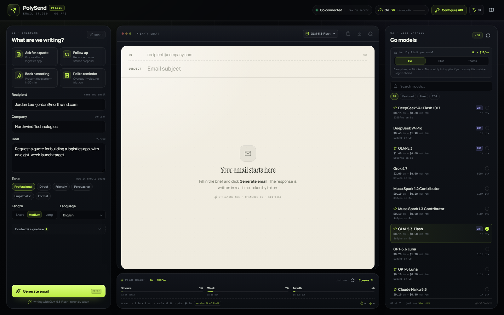

# PolySend

**English** · [Português](README.pt-BR.md)

**PolySend** is a live email-writing studio powered by **OpenCode Go** models.



The UI is a **single responsive dashboard** with no page scroll: brief on the left, email in the
center, and the live model catalog on the right. Plan usage stays visible right below the email.
On smaller screens the catalog becomes a drawer; on phones the app switches to tabs
(Briefing / Email / Models).

The interface ships in **English (default)** and **Portuguese**, with an EN/PT toggle in the
header. The language used to write the email is a separate field in the brief, so you can have
an English UI and a Portuguese email.

The live Go catalog (31 models at the moment) shows prices per 1M tokens, the monthly limit per
model, and real plan usage (5-hour, weekly, and monthly windows). Text is streamed token by token
over SSE and can be edited, refined, or rewritten by selection.

```
React + Vite  ·  Node/Express  ·  OpenCode Go API  ·  SSE
```

## Run

Requirements: Node 20+.

```bash
npm install
cp .env.example .env   # if you don't have a .env yet
npm run dev
```

Open `http://localhost:5173`.

On Windows (PowerShell):

```powershell
Copy-Item .env.example .env
npm run dev
```

This project already has a `.env` and the server reads the key from there. You can also paste a
different key in the **Configure API** panel without restarting anything.

### Production build

```bash
npm run build
npm start
```

Runs at `http://localhost:8787` (Express serves the Vite build and the `/api` routes).

## How the demo works

1. **Live catalog** — the list comes from `GET https://opencode.ai/inference/go/v1/models`. It
   shows name, input/output price, context, ZDR/free badges, and the monthly limit per model on
   the selected plan (Go, Go Plus, or Go Teams).
2. **Brief** — recipient, company, goal, tone, length, language, context, and signature. Four
   ready-made examples: quote request, follow-up, meeting, and invoice reminder.
3. **Real streaming** — the backend opens the Go API stream and forwards deltas over SSE. The
   subject is separated from the body in the first chunk of the response.
4. **Plan usage** — `GET https://opencode.ai/inference/go/v1/usage` returns the real 5-hour,
   weekly, and monthly windows. The panel refreshes after each generation and every 60 seconds.
   Each response also carries `usage.opencode.allowance`, which feeds the session total.
5. **Text manipulation** — after generating, click **Edit text** to edit by hand. Select a
   passage and rewrite only that passage. The **Adjust with AI** chips rewrite the whole body
   (shorter, formal, persuasive, CTA, translation), also as a stream.
6. **Bilingual UI** — English is the default. Use the **EN/PT** button in the header to switch
   the interface; the choice is saved in `localStorage`. Presets and error messages follow the
   selected language. The output language is chosen in the brief independently.

### Suggested live-demo script

1. Open the app and show the catalog on the right: 31 models, prices, and limits. For a smoother
   live demo, use **GLM-5.3-Flash** (the default) or **Claude Haiku 5.5** — reasoning-heavy
   models can take longer to produce the first token.
2. Click **Ask for a quote** (or type your own brief), then **Generate email**. Point out the
   subject and body being written live, the caret, and the **LIVE** indicator.
3. When it finishes, show tokens, TTFT, tok/s in the email status bar and the real plan usage
   (5 hours / week / month) always visible below.
4. Click **Edit text**, select a paragraph, and rewrite just that with an instruction
   (“more direct, focus on the deadline”). Show the replacement in real time.
5. Use **Shorter** and **Translate to Portuguese** to show refinement on an existing text.
6. Open **Configure API**, paste your friend's key, and show live validation (the catalog
   reloads instantly).
7. To finish, open the **Console** link in the usage bar or show
   `https://opencode.ai/console/go` with the real usage windows.

## Architecture

```
src/
  App.tsx                 session state, streaming, shortcuts, connection
  components/
    Header.tsx            key status, plan, language toggle
    BriefingPanel.tsx     form + localized examples
    EmailCanvas.tsx       email paper, editing, selection, refinements
    UsageBar.tsx          real plan usage + session metrics
    ModelsPanel.tsx       live Go catalog, search, filters, plans
    MobileTabs.tsx        Briefing / Email / Models navigation on phones
    KeyModal.tsx          API configuration from the panel
  lib/
    api.ts                fetch + SSE parser
    i18n.tsx              English/Portuguese UI dictionaries + provider
    errors.ts             API/stream error localization by code
    presets.ts            localized briefs, tones, lengths, languages
server/
  index.mjs               Express routes, SSE, validation
  opencode.mjs            Go API client (models, usage, chat completions)
  prompts.mjs             generation, refinement, and selection prompts
```

### Backend endpoints

| Method | Route               | What it does |
| ------ | ------------------- | ------------ |
| GET    | `/api/health`       | server status and whether a key exists in `.env` |
| GET    | `/api/models`       | normalized Go catalog (uses `.env` or `x-opencode-key`) |
| GET    | `/api/usage`        | real Go plan usage windows |
| POST   | `/api/email/stream` | generates/refines and streams SSE (`subject`, `delta`, `usage`, `done`, `error`) |

The client picks the model, brief, and mode (`generate`, `refine`, or `selection`). The backend
builds the prompts and calls
`https://opencode.ai/inference/go/openai/v1/chat/completions` with `stream: true`,
`stream_options.include_usage`, and a stable `x-opencode-session`.

### Models and reasoning

All text models work through Go's Chat Completions endpoint (Console translates when the model
speaks another API). For faster email responses, the app sends a low `reasoning_effort` when the
model declares support; models that only accept a high effort keep their default.

## A note about OpenCode Go

Go is intended for **coding-agent traffic**, and OpenCode monitors abuse that degrades the
experience for other users. This demo sends its own User-Agent and a stable
`x-opencode-session`, but email generation is not Go's primary use case. For a production
product, use **OpenCode Models pay-as-you-go** or your own provider keys. For a live demo with
friends, Go works nicely.

## API key and security

- The `.env` key stays **server-side only** and is never sent to the browser.
- A key pasted in the panel stays in that tab's `sessionStorage` and is sent to **your local
  backend** only with requests; the server does not persist it to disk.
- For production, keep the key on the server and remove the client's ability to send
  `x-opencode-key` (or protect the app with authentication). This project is a local demo: do
  not expose the server publicly without authentication and rate limiting.
- `.env` is in `.gitignore`. Do not commit your key. If it leaks, revoke it and create another
  one in the Console under **Account › Personal API keys**.

## Quick customization

- **Change the examples**: `src/lib/presets.ts`.
- **Change the UI copy / add a language**: `src/lib/i18n.tsx`.
- **Change the server prompts**: `server/prompts.mjs`.
- **Change the initial model**: `MODEL_STORAGE`/`selectedId` in `src/App.tsx`.
- **Change the colors**: CSS variables at the top of `src/styles.css`.
- **Use another default plan**: the `plan` selector in `src/App.tsx` (Go, Go Plus, Go Teams).

## Docs

- OpenCode Go: <https://opencode.ai/docs/console/go>
- Inference API: <https://opencode.ai/docs/console/api/inference>
- Model list: <https://opencode.ai/docs/console/api/models>
- Console: <https://opencode.ai/console>
