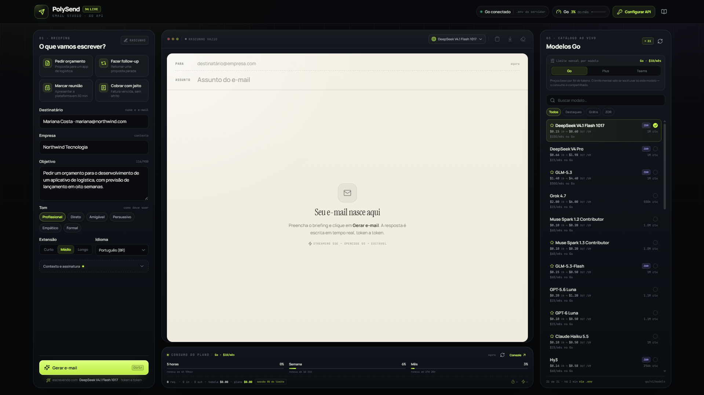
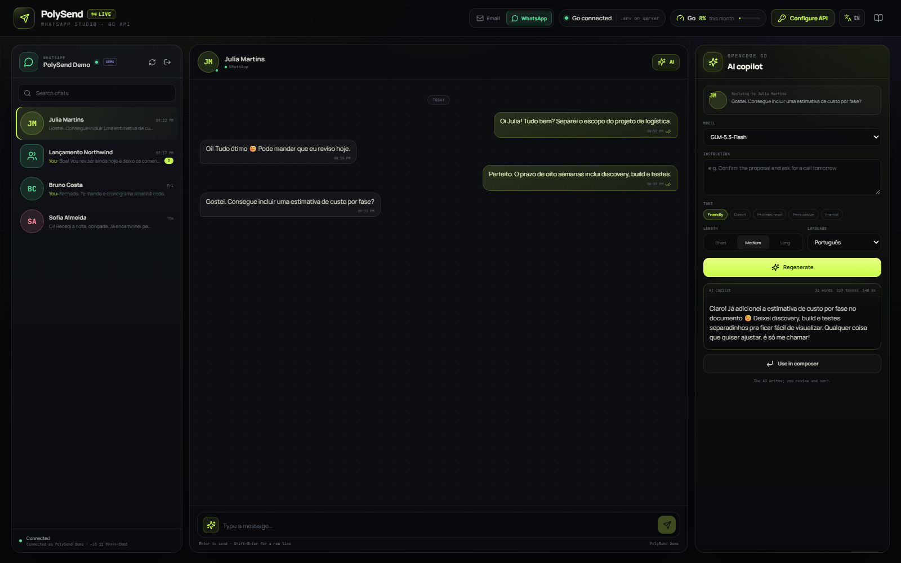
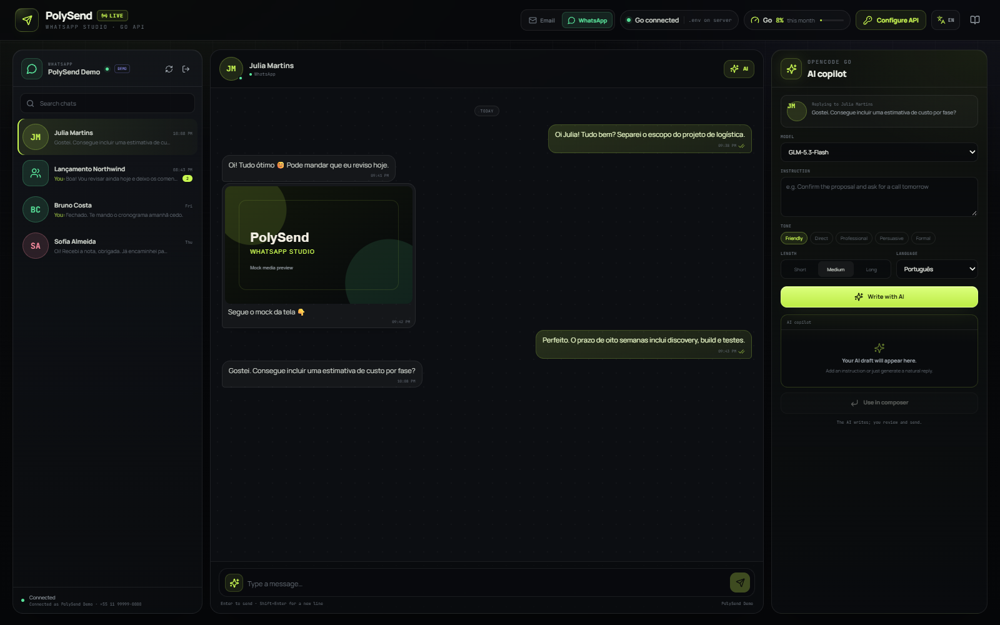

# PolySend

[English](README.md) · **Português**

**PolySend** é uma demo de e-mails escritos **em tempo real** com os modelos do **OpenCode Go**.



A interface é um **único painel responsivo** (sem scroll na página): briefing à esquerda,
e-mail no centro e catálogo à direita. A barra de consumo do plano fica sempre visível logo
abaixo do e-mail. Em telas menores o catálogo vira um drawer e, no celular, a navegação vira
abas (Briefing / E-mail / Modelos).

A interface está disponível em **inglês (padrão)** e **português**, com um botão EN/PT no header.
O idioma do e-mail é um campo separado no briefing, então você pode ter a interface em inglês e
gerar um e-mail em português.

Um segundo workspace adiciona o **WhatsApp Studio**: um painel de conversas ao vivo com um
copiloto de IA que escreve respostas token a token. Alterne entre **E-mail** e **WhatsApp** no
header.

O catálogo Go ao vivo (31 modelos no momento) mostra preços por 1M de tokens, limite mensal por
modelo e o consumo real do plano (janela de 5h, semana e mês). O texto é transmitido token a
token por SSE e pode ser editado, refinado ou reescrito por seleção.

Quando o rascunho estiver pronto, **Enviar** entrega um e-mail de verdade pelo **Resend**, com
identidade de remetente, verificação de domínio, envio de teste e histórico por sessão no app.

O workspace de WhatsApp conecta pelo **Baileys** (API não oficial do WhatsApp Web) e mantém a
mesma linguagem visual: lista de conversas, thread e copiloto de IA em streaming.

```
React + Vite  ·  Node/Express  ·  OpenCode Go API  ·  SSE  ·  Resend  ·  Baileys
```

## Rodar

Requisitos: Node 20+.

```bash
npm install
cp .env.example .env   # se ainda não existir um .env
npm run dev
```

Abra `http://localhost:5173`.

No Windows (PowerShell), use:

```powershell
Copy-Item .env.example .env
npm run dev
```

O `.env` deste projeto já está preenchido e o servidor lê a chave de lá. Você também pode
colar outra chave direto no painel **Configurar API**, sem reiniciar nada.

### Build de produção

```bash
npm run build
npm start
```

Abre em `http://localhost:8787` (Express serve o build do Vite e as rotas `/api`).

## Como a demo funciona

1. **Catálogo ao vivo** — a lista vem de `GET https://opencode.ai/inference/go/v1/models`.
   Mostra nome, preço de entrada/saída, contexto, badges de ZDR/grátis e limite mensal por
   modelo no plano escolhido (Go, Go Plus ou Go Teams).
2. **Briefing** — destinatário, empresa, objetivo, tom, extensão, idioma, contexto e assinatura.
   Quatro exemplos prontos: orçamento, follow-up, reunião e cobrança.
3. **Streaming de verdade** — o backend abre o stream da API Go e repassa os deltas via SSE.
   O assunto é separado do corpo no primeiro trecho da resposta.
4. **Consumo do plano** — `GET https://opencode.ai/inference/go/v1/usage` retorna as janelas
   reais de 5h, semana e mês. A cada geração o painel é atualizado; ele também atualiza sozinho
   a cada 60s. Cada resposta traz `usage.opencode.allowance`, usado no acumulado da sessão.
5. **Manipulação de texto** — depois de gerar, clique em **Editar texto** para editar à mão.
   Selecione um trecho e peça uma reescrita só daquele trecho. Os chips **Ajustar com IA**
   reescrevem o corpo inteiro (mais curto, formal, persuasivo, CTA, tradução), também em stream.
6. **Interface bilíngue** — inglês é o padrão. Use o botão **EN/PT** no header para trocar o
   idioma da interface; a escolha fica salva no `localStorage`. Exemplos e mensagens de erro
   seguem o idioma escolhido. O idioma do e-mail é definido no briefing, de forma independente.
7. **WhatsApp Studio** — alterne para **WhatsApp** no header para ler e enviar conversas reais.
   O copiloto usa as mensagens recentes como contexto, detecta o idioma e escreve a próxima
   resposta em streaming num rascunho que você revisa antes de enviar.

### Roteiro sugerido para a live

1. Abra o app e mostre o catálogo à direita: 31 modelos, preços e limites. Para uma live mais
   fluida, use **GLM-5.3-Flash** (o padrão) ou **Claude Haiku 5.5** — modelos com raciocínio
   longo podem demorar mais para o primeiro token.
2. Clique em **Pedir orçamento** (ou digite um briefing), depois em **Gerar e-mail**. Aponte
   para o assunto e o corpo sendo escritos ao vivo, o caret e o indicador **AO VIVO**.
3. Terminada a geração, mostre os tokens, TTFT e tok/s na barra inferior do e-mail e o consumo
   real do plano (5h / semana / mês) sempre visível logo abaixo.
4. Clique em **Editar texto**, selecione um parágrafo e reescreva só ele com uma instrução
   (“mais direto, foco no prazo”). Mostre a substituição em tempo real.
5. Use **Mais curto** e **Traduzir p/ inglês** para mostrar refinamento sobre um texto existente.
6. Abra **Configurar API**, cole a chave do seu amigo e mostre a validação ao vivo (o catálogo
   recarrega na hora).
7. Abra **Envio › Configurações**, conecte uma chave do Resend e mostre o domínio verificado e o
   remetente. Depois use **Enviar** no e-mail, revise o destinatário e entregue o rascunho de
   verdade. Mostre o ID do Resend e o evento de entrega no histórico.
8. Alterne para **WhatsApp**, abra uma conversa e clique em **Escrever com IA**. Mostre a resposta
   sendo escrita token a token, use no campo e envie.
9. Para fechar, abra o **Console** pelo link da barra de consumo ou mostre
   `https://opencode.ai/console/go` com as janelas reais.

## Enviar com o Resend

O envio é uma **camada de provider** em `server/delivery/`. O Resend é o primeiro adaptador;
SMTP, Amazon SES e outros podem entrar atrás das mesmas rotas sem mexer no estúdio de e-mails.

### 1. Conectar uma chave do Resend

Crie a chave em <https://resend.com/api-keys> e escolha:

- abrir **Envio › Configurações** no app, colar a chave e clicar em **Validar e conectar**; ou
- colocar a chave no `.env` como `RESEND_API_KEY`.

O caminho do painel valida a chave no Resend e grava no `.env` do servidor local como
`RESEND_API_KEY`, então ela continua após reiniciar o app ou fechar a aba. Se o servidor não
conseguir escrever no `.env` (por exemplo, em deploy somente leitura), a chave fica apenas no
`sessionStorage` daquela aba e é enviada pelo header `x-resend-key`. O `.env` está no
`.gitignore`; nunca faça commit dele.

Os dois tipos de chave funcionam:

| Tipo de chave | O que habilita |
| ------------- | -------------- |
| **Acesso total** | Envio, listagem de domínios, verificação de domínio e atualização de status |
| **Somente envio** | Envio, e-mail de teste e histórico; domínios e status ficam ocultos porque o Resend bloqueia essas leituras |

### 2. Verificar um domínio e escolher o remetente

O Resend só entrega a partir de um **domínio verificado**. Adicione o domínio em
<https://resend.com/domains>, publique os registros DNS que o Resend mostrar, use **Domínios de
envio › Verificar** no painel e atualize. O endereço `onboarding@resend.dev` serve para testes
rápidos, mas só chega ao e-mail do dono da conta Resend.

Em **Identidade do remetente**, defina o nome de exibição, o endereço **De** em um domínio
verificado e um **Responder para** opcional. O painel sugere endereços para cada domínio
verificado. Essas preferências ficam no navegador (`localStorage`), não no servidor.

### 3. Enviar e acompanhar

- A ação **Enviar** no papel do e-mail abre **Envio › Enviar** com o destinatário preenchido a
  partir do briefing quando ele contém um e-mail.
- Marque **Revisei o conteúdo** e clique em **Enviar e-mail**. O assunto e o corpo do rascunho
  vão como HTML e como alternativa em texto puro.
- Após o aceite, o ID do Resend aparece e pode ser copiado com um clique. A aba
  **Configurações** guarda os últimos envios da sessão; use atualizar para ler o evento mais
  recente (`delivered`, `bounced`, `complained`, `delivery_delayed` etc.) no Resend.
- **E-mail de teste** envia uma mensagem pequena e fixa com o remetente e a chave atuais, útil
  antes de uma demo ao vivo.

### Entregabilidade e proteções

- O texto puro é convertido em HTML simples com estilos inline, **sem pixel de rastreamento,
  sem imagens remotas e sem reescrita de links**, o que ajuda a manter a mensagem fora de
  filtros de spam.
- Toda mensagem leva uma parte em texto puro, um `Reply-To` normal e o header
  `Idempotency-Key`, que evita envio duplicado em retentativas.
- O domínio do **De** é comparado com a lista de domínios verificados; um aviso aparece quando o
  remetente não corresponde a nenhum.
- Os envios são limitados no servidor por sessão e IP (`RESEND_SEND_LIMIT_PER_HOUR`, padrão
  **20/hora**). E-mails de teste contam no limite.
- Erros do provider voltam com código estável, mensagem legível e o detalhe bruto em
  **Detalhes do provider**.

Padrões opcionais no `.env`:

```dotenv
RESEND_API_KEY=
RESEND_FROM_NAME=PolySend
RESEND_FROM_EMAIL=hello@seudominio.com
RESEND_REPLY_TO=voce@seudominio.com
RESEND_SEND_LIMIT_PER_HOUR=20
# Use apenas para mocks/testes locais
RESEND_BASE_URL=https://api.resend.com
```

### Adicionar outro provider

Crie um adaptador em `server/delivery/` com as mesmas operações usadas por
`server/delivery/resend.mjs` (validar chave, listar/verificar domínios, enviar, consultar
status) e selecione-o nas rotas de envio. A interface já mostra o nome do provider, então um
segundo adaptador entra sem alterar o estúdio.

## WhatsApp Studio





Alterne para **WhatsApp** no header. O workspace tem três painéis: conversas à esquerda, a thread
ao vivo no centro e o copiloto de IA à direita.

### 1. Conectar o celular

1. Abra **WhatsApp** no app e clique em **Conectar WhatsApp**.
2. No celular, vá em **Configurações → Dispositivos conectados → Conectar dispositivo**.
3. Escaneie o QR code mostrado no app.

A sessão fica local em `.wa-auth/` (fora do Git) e reconecta sozinha após reiniciar o servidor.
**Desconectar** apaga a pasta de autenticação e pede um novo QR code.

A integração usa o **Baileys**, um cliente não oficial do WhatsApp Web. Use um número seu, siga os
termos do WhatsApp e saiba que automação pode levar a banimento. Não use seu número principal
para experimentar.

### 2. Conversar em tempo real

- A lista de conversas e a thread aberta atualizam por **SSE** conforme as mensagens chegam, com
  badges de não lidas e busca. Se o stream cair, a UI faz polling até reconectar. Não é preciso
  webhook público: o servidor mantém um WebSocket com o WhatsApp e repassa os eventos ao navegador.
- Envie com **Enter**; **Shift+Enter** quebra a linha. Mensagens recebidas, grupos e mensagens
  enviadas são suportados.
- O histórico é solicitado quando o dispositivo é vinculado. Se a conta foi vinculada antes do
  full sync ser habilitado, use **Importar conversas antigas** (ou Desconecte e escaneie o QR
  novamente) uma vez; a lista se preenche sozinha conforme os lotes chegam.
- Conversas e mensagens recentes ficam em cache em `.wa-store.json` (fora do Git). Conversas e
  grupos apagados saem do cache quando o WhatsApp avisa. Ao reconectar, o servidor também confere
  em quais grupos você ainda participa e remove os demais; tombstones impedem que uma nova
  sincronização de histórico os traga de volta.
- **Limpar conversas em cache** (ícone de lixeira) apaga o cache local e reconecta para reconstruir
  a lista atual do WhatsApp sem desvincular o dispositivo.
- **Mídia é exibida inline**: fotos e stickers abrem em lightbox, vídeos e áudios usam os players
  nativos, e documentos baixam com o nome original. A mídia é baixada sob demanda e fica em cache
  na memória durante a sessão do servidor.
- Enviar anexos pelo composer, reações e chamadas ainda não estão implementados.

### 3. Escrever com o copiloto de IA

- O copiloto lê as últimas mensagens da conversa selecionada e usa isso como contexto.
- Escolha **instrução**, **tom**, **extensão** e **idioma**. O idioma é detectado automaticamente
  pela conversa, e você pode sobrescrever.
- **Escrever com IA** transmite o rascunho token a token no card. **Usar no campo** leva o texto
  para a caixa de mensagem para revisão final.
- O modelo vem do mesmo catálogo Go do estúdio de e-mail e usa a mesma chave do OpenCode.

### Modo demo

Para explorar a interface sem escanear um QR code:

```powershell
$env:WHATSAPP_MOCK='1'; npm start
```

O servidor cria quatro conversas de exemplo e simula respostas. O copiloto continua chamando o
OpenCode Go de verdade. Remova `WHATSAPP_MOCK` (ou use `0`) para usar o WhatsApp real.

### Endpoints do WhatsApp

| Método | Rota | O que faz |
| ------ | ---- | --------- |
| GET    | `/api/whatsapp/status` | estado da conexão, QR e conta vinculada |
| POST   | `/api/whatsapp/connect` | inicia o socket Baileys e o fluxo de QR |
| POST   | `/api/whatsapp/logout` | desvincula o dispositivo e limpa `.wa-auth` |
| POST   | `/api/whatsapp/cache/clear` | limpa o cache de conversas e reconecta para reconstruir a lista |
| GET    | `/api/whatsapp/chats` | lista de conversas, mais recentes primeiro |
| GET    | `/api/whatsapp/chats/:jid/messages` | mensagens de uma conversa e marca como lida |
| POST   | `/api/whatsapp/chats/:jid/messages` | envia uma mensagem de texto |
| POST   | `/api/whatsapp/chats/:jid/read` | zera o contador de não lidas |
| GET    | `/api/whatsapp/media/:id` | baixa e serve foto, vídeo, áudio ou documento |
| GET    | `/api/whatsapp/events` | stream SSE de status, conversas e novas mensagens |
| POST   | `/api/whatsapp/ai/stream` | transmite o rascunho da IA (`delta`, `usage`, `done`) |

## Arquitetura

```
src/
  App.tsx                 estado da sessão, streaming, atalhos, conexão
  components/
    Header.tsx            status da chave, plano e seletor de idioma
    BriefingPanel.tsx     formulário + exemplos localizados
    EmailCanvas.tsx       papel do e-mail, edição, seleção e refinamentos
    UsageBar.tsx          consumo real do plano + métricas da sessão
    ModelsPanel.tsx       catálogo Go ao vivo, busca, filtros e planos
    MobileTabs.tsx        navegação Briefing / E-mail / Modelos no celular
    KeyModal.tsx          configuração da API pelo painel
    DeliveryModal.tsx     chave do Resend, domínios, remetente, teste e histórico
    whatsapp/
      WhatsAppStudio.tsx       estado do workspace, SSE, IA e layout
      WhatsAppChatList.tsx     busca, badges de não lidas e lista de conversas
      WhatsAppConversation.tsx mensagens, composer e auto-scroll
      WhatsAppCopilot.tsx      instrução, tom, idioma e rascunho em streaming
      WhatsAppConnect.tsx      pareamento por QR e estados de conexão
      WhatsAppAvatar.tsx       iniciais / avatar de grupo
  lib/
    api.ts                fetch + parser SSE
    delivery.ts           helpers da API de envio e parsing de e-mail
    whatsapp.ts           API de chats, eventos SSE, stream de IA e idioma
    i18n.tsx              dicionários EN/PT + provider de idioma
    errors.ts             tradução de erros da API/stream por código
    presets.ts            briefings, tons, extensões e idiomas localizados
server/
  index.mjs               rotas Express, SSE, validação e rotas de envio
  opencode.mjs            cliente da API Go (modelos, usage, chat completions)
  prompts.mjs             prompts de geração, refinamento e seleção
  delivery/
    resend.mjs            adaptador REST do Resend, chave, envio e status
    env.mjs               grava a chave do painel no .env do servidor
    templates.mjs         template HTML inline a partir do texto puro
    store.mjs             histórico de envios por sessão
  whatsapp/
    session.mjs           socket Baileys, QR, reconexão, mensagens e mídia
    store.mjs             cache de conversas/mensagens (`.wa-store.json`)
    prompts.mjs           prompts do copiloto de WhatsApp
```

### Endpoints do backend

| Método | Rota                | O que faz |
| ------ | ------------------- | --------- |
| GET    | `/api/health`       | status do servidor, chave Go e padrões do Resend |
| GET    | `/api/models`       | catálogo Go normalizado (usa a chave do `.env` ou `x-opencode-key`) |
| GET    | `/api/usage`        | janelas reais de consumo do plano Go |
| POST   | `/api/email/stream` | gera/refina e transmite SSE (`subject`, `delta`, `usage`, `done`, `error`) |
| GET    | `/api/delivery/status` | valida a chave do Resend e retorna domínios, escopos e padrões |
| POST   | `/api/delivery/key` | valida a chave do painel e salva no `.env` do servidor |
| POST   | `/api/delivery/domains/:id/verify` | pede ao Resend para reverificar o DNS do domínio |
| POST   | `/api/delivery/send` | envia o rascunho revisado e registra no histórico da sessão |
| GET    | `/api/delivery/history` | lista os envios da sessão atual |
| GET    | `/api/delivery/history/:id` | atualiza o último evento de um envio no Resend |
| GET    | `/api/whatsapp/status` | estado da conexão, QR e conta vinculada |
| POST   | `/api/whatsapp/connect` | inicia o socket Baileys e o QR |
| POST   | `/api/whatsapp/logout` | desvincula o dispositivo e limpa `.wa-auth` |
| POST   | `/api/whatsapp/cache/clear` | limpa o cache de conversas e reconecta para reconstruir a lista |
| GET    | `/api/whatsapp/chats` | lista de conversas, mais recentes primeiro |
| GET    | `/api/whatsapp/chats/:jid/messages` | mensagens de uma conversa |
| POST   | `/api/whatsapp/chats/:jid/messages` | envia uma mensagem de texto |
| GET    | `/api/whatsapp/media/:id` | baixa e serve foto, vídeo, áudio ou documento |
| GET    | `/api/whatsapp/events` | SSE de status, conversas e mensagens |
| POST   | `/api/whatsapp/ai/stream` | transmite o rascunho da IA (`delta`, `usage`, `done`) |

As rotas de envio pegam a chave de `x-resend-key` (painel) ou `RESEND_API_KEY` (servidor) e a
sessão de `x-session-id`. As rotas de WhatsApp operam na única conta vinculada a este servidor.

O cliente escolhe o modelo, o briefing e o modo (`generate`, `refine` ou `selection`). O
backend monta os prompts e chama `https://opencode.ai/inference/go/openai/v1/chat/completions`
com `stream: true`, `stream_options.include_usage` e um `x-opencode-session` estável.

### Modelos e raciocínio

Todos os modelos de texto funcionam pelo endpoint de Chat Completions do Go (o Console traduz
quando o modelo fala outra API). Para respostas mais rápidas em e-mails, o app envia
`reasoning_effort` baixo quando o modelo declara suporte; modelos que só aceitam esforço alto
ficam no padrão.

## Nota sobre o OpenCode Go

O Go é pensado para **tráfego de coding agents** e a OpenCode monitora abuso que degrade a
experiência de outros usuários. Esta demo manda um User-Agent próprio e um `x-opencode-session`
estável, mas geração de e-mails e mensagens de WhatsApp não é o caso de uso principal do Go. Para
um produto em produção, o caminho recomendado é usar **OpenCode Models pay-as-you-go** ou as
chaves dos seus próprios providers. Para a demo ao vivo com amigos, o Go funciona bem.

## Chaves de API e segurança

- As chaves do OpenCode e do Resend podem ficar no `.env` e permanecem **somente no backend**;
  nunca são enviadas ao navegador.
- A chave do OpenCode no painel fica no `sessionStorage` daquela aba e é enviada apenas ao seu
  backend local. A chave da Resend é validada e salva no `.env` do servidor local
  (`RESEND_API_KEY`) para continuar após reiniciar; o `.env` fica fora do Git.
- Para produção, mantenha as chaves só no servidor e remova a possibilidade de o cliente enviar
  `x-opencode-key` / `x-resend-key` (ou proteja o app com autenticação). Este projeto é uma demo
  local: não exponha o servidor publicamente sem autenticação/rate limit.
- `.env` está no `.gitignore`. Não faça commit das suas chaves. Se uma vazar, revogue e crie
  outra: OpenCode Console em **Account › Personal API keys**, Resend em **API Keys**.
- `.wa-auth/` contém as credenciais da sessão do WhatsApp e nunca deve ir para o Git nem ser
  compartilhada. `.wa-store.json` guarda o cache de conversas e também está fora do Git.
  **Desconectar** apaga a autenticação; excluir o store limpa o cache local.
- A integração de WhatsApp é não oficial e pode gerar restrições na conta. Mantenha o servidor
  local e use um número que você aceita arriscar.

## Ajustes rápidos

- **Mudar os exemplos**: `src/lib/presets.ts`.
- **Mudar textos / adicionar um idioma**: `src/lib/i18n.tsx`.
- **Mudar os prompts de e-mail**: `server/prompts.mjs`.
- **Mudar o prompt do copiloto de WhatsApp**: `server/whatsapp/prompts.mjs`.
- **Mudar as conversas de demo**: `seedMockChats` em `server/whatsapp/store.mjs`.
- **Mudar o modelo inicial**: `MODEL_STORAGE`/`selectedId` em `src/App.tsx`.
- **Mudar as cores**: variáveis CSS no topo de `src/styles.css`.
- **Outro plano como padrão**: seletor `plan` em `src/App.tsx` (Go, Go Plus, Go Teams).

## Documentação

- OpenCode Go: <https://opencode.ai/docs/console/go>
- API de inferência: <https://opencode.ai/docs/console/api/inference>
- Lista de modelos: <https://opencode.ai/docs/console/api/models>
- Console: <https://opencode.ai/console>
- API do Resend: <https://resend.com/docs/api-reference/introduction>
- Domínios no Resend: <https://resend.com/docs/dashboard/domains/introduction>
- Baileys (WhatsApp): <https://github.com/WhiskeySockets/Baileys>
- Dispositivos conectados do WhatsApp: <https://faq.whatsapp.com/1317564962313205>
